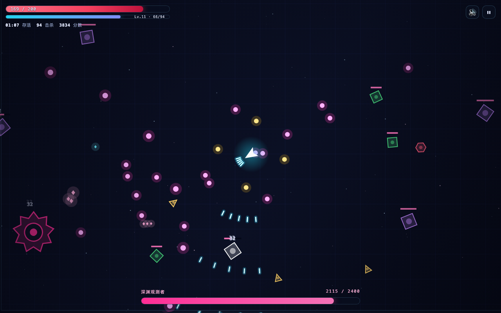

# 霓虹幸存者 · Neon Survivor

深空回廊里的单局肉鸽弹幕生存：**武器全自动开火，你只管走位和选强化**，活到 90 秒并击穿「深渊观测者」，或者继续无尽模式。

纯前端实现，零依赖、零构建、无素材文件，一张网页就能跑。



## 上手

在线试玩：<https://weicoz.github.io/neon-survivor/>

本地运行（ES Module 需要 HTTP 服务，不能直接双击 `index.html`）：

```bash
npm start            # 默认 http://localhost:5173
# 或者不装 node 的任何东西
python3 -m http.server 5173
```

## 操作

| 操作 | 键盘 | 触屏 |
| --- | --- | --- |
| 移动 | `W` `A` `S` `D` 或方向键 | 按住屏幕拖动（虚拟摇杆） |
| 冲刺（0.16 秒无敌，1.5 秒冷却） | `Space` | 轻点屏幕 |
| 选升级卡 | `1` `2` `3` 或点击 | 点击 |
| 暂停 / 静音 / 重开 | `P`（或 `Esc`）/ `M` / `R` | 右上角按钮 |

## 玩法

- **自动开火**：每帧锁定最近的敌人射击，玩家不需要瞄准。
- **三选一强化**：拾取经验晶体升级，从 10 种强化里选 1 张，每种有等级上限。
- **难度爬升**：敌人血量随存活时间线性增长，每 18 秒来一波敌群突袭。
- **90 秒 Boss**：深渊观测者会环形弹幕、三连瞄准射击并召唤小怪；击破后进入胜利结算，可继续无尽。
- **构筑方向**：射速流（超频回路）、爆发流（过载核心 + 分裂弹头 + 穿甲弹芯）、近身流（轨道刃 + 冲击新星）、生存流（纳米装甲 + 再生涂层）。
- **记录**：最佳分数、最佳存活时间、击杀数存在 `localStorage`。

强化一览：超频回路、过载核心、分裂弹头、穿甲弹芯、矢量推进器、纳米装甲、引力线圈、冲击新星、轨道刃、再生涂层。

## 架构

```
index.html            页面骨架 + HUD + 全部覆盖层
styles/game.css       霓虹暗色 UI，响应式布局，支持安全区
src/core/             纯逻辑，不碰 DOM，可在 Node 里直接跑
  config.js           全部数值：玩家、敌人、Boss、节奏曲线
  mathx.js rng.js     向量工具、可复现随机数
  upgrades.js         强化卡池 + 属性推导 + 抽卡
  world.js            世界状态与 update(world, dt, input)
src/render/renderer.js  Canvas 2D 绘制（热点循环不用 shadowBlur，用多层描边模拟发光）
src/platform/          WebAudio 程序化音效、键盘 + 触屏输入
src/main.js            主循环、HUD 同步、覆盖层状态机
scripts/serve.js       零依赖静态服务器
scripts/sim-balance.mjs 机器人跑完整局，输出难度曲线
test/                  node:test 单元测试与 120 秒冒烟模拟
```

设计约束：

1. **模拟层与渲染层分离**：`world.js` 只处理数据，`update()` 是纯函数式推进，所以能在 Node 里单元测试和批量跑平衡模拟。
2. **数值集中**：调平衡只改 `src/core/config.js`，不散落在逻辑里。
3. **确定性**：随机数走 `mulberry32`，同种子同输入得到完全一致的战局（有测试守着），方便复现 bug 与做机器人对比。

## 开发

```bash
npm test         # 17 个测试：随机数、抽卡、战斗、升级、Boss、120 秒冒烟、确定性
npm run sim      # 5 个种子的机器人对局，打印等级/击杀/存活时间
npm start        # 本地服务器
```

调试钩子：打开 `?debug=1` 后可在控制台访问 `window.__neon`。

```js
__neon.world            // 当前世界状态
__neon.step(30)         // 快进 30 秒（自动选第一张升级卡）
__neon.grantAll()       // 拉满全部强化，直接看后期特效
__neon.start()          // 重开一局
```

## 兼容性

需要支持 ES Module、Canvas 2D 与 WebAudio 的现代浏览器（Chrome / Edge / Safari / Firefox 近两年版本）。iOS Safari 首次触摸会自动解锁音频。

## 许可

[MIT](LICENSE)
